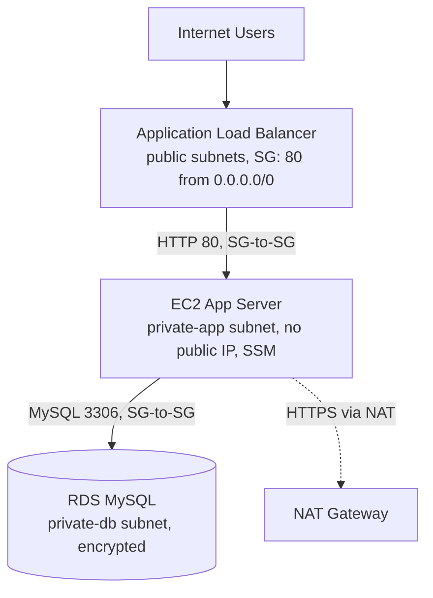

# Secure Web Application on AWS

A cloud-security capstone that provisions a three-tier web application on AWS entirely with Terraform, with defense-in-depth network isolation, encrypted data stores, and full audit logging (VPC Flow Logs + CloudTrail).

## Overview

The stack serves a simple Apache page behind an Application Load Balancer, while the app server and database are kept fully private. Traffic flows through chained security groups, the database is provably unreachable from the internet, and every action is logged.

- **Presentation tier** — an internet-facing ALB in public subnets.
- **Application tier** — an Amazon Linux 2023 EC2 instance in private subnets, with no public IP, managed via SSM.
- **Data tier** — an RDS for MySQL instance in isolated DB subnets with no internet route.

## Architecture

See [`architecture.svg`](architecture.svg) for the full diagram. The request path:



- **Public subnets** (`10.0.1.0/24`, `10.0.2.0/24`) hold only the ALB; route `0.0.0.0/0` → IGW.
- **Private app subnets** (`10.0.11.0/24`, `10.0.12.0/24`) hold the EC2 instance; route `0.0.0.0/0` → NAT.
- **Private DB subnets** (`10.0.21.0/24`, `10.0.22.0/24`) hold RDS; no route to the internet.

## Repository structure

| File | Responsibility |
|---|---|
| `versions.tf` | Terraform & AWS provider config, default tags |
| `variables.tf` | Region, CIDRs, sizes, DB credentials (all defaulted) |
| `network.tf` | VPC, 6 subnets, IGW, NAT gateway, route tables |
| `security_groups.tf` | ALB, App, DB security groups (SG-to-SG rules) |
| `alb.tf` | Application Load Balancer, target group, HTTP listener |
| `compute.tf` | EC2 app server (private, IMDSv2, SSM, encrypted EBS) |
| `database.tf` | RDS MySQL (private, encrypted, Secrets Manager password) |
| `monitoring.tf` | VPC Flow Logs → CloudWatch, CloudTrail → S3 |
| `outputs.tf` | ALB URL, instance ID, RDS endpoint, secret ARN |
| `architecture.svg` | Architecture diagram |

> All resources are prefixed with `var.project_name` (default `secure-webapp`), e.g. `secure-webapp-vpc`, `secure-webapp-alb`, `secure-webapp-db`.

## Prerequisites

- An AWS account with the CLI configured (`aws configure`) and permissions for EC2, VPC, ELB, RDS, IAM, S3, CloudTrail, CloudWatch, and Secrets Manager.
- Terraform ≥ 1.5.

## Quick start

```bash
terraform init
terraform fmt -check
terraform validate
terraform plan -out tfplan
terraform apply tfplan
```

Allow 5–10 minutes (RDS provisioning is the slow part), then open the `alb_dns_name` output in a browser.

Key outputs:

| Output | Use |
|---|---|
| `alb_dns_name` | Open this URL to view the app |
| `app_instance_id` | Connect via `aws ssm start-session --target <id>` |
| `rds_endpoint` | The private DB hostname |
| `rds_secret_arn` | Secrets Manager secret holding the generated DB password |
| `flow_log_group` | CloudWatch log group for Flow Logs |
| `cloudtrail_bucket` | S3 bucket receiving CloudTrail logs |

## Teardown

```bash
terraform destroy
```

> **Cost note:** the NAT Gateway and the RDS instance incur charges while they exist — destroy the stack when you're done.

## Configuration

All values are optional (defaults shown below). Override them with a `terraform.tfvars` file or `-var` flags.

| Variable | Default | Description |
|---|---|---|
| `aws_region` | `ap-southeast-2` | Deployment region (Sydney) |
| `project_name` | `secure-webapp` | Prefix for every resource name |
| `environment` | `dev` | Environment tag |
| `vpc_cidr` | `10.0.0.0/16` | VPC CIDR |
| `azs` | `ap-southeast-2a`, `ap-southeast-2b` | Two availability zones |
| `public_subnet_cidrs` | `10.0.1.0/24`, `10.0.2.0/24` | Public subnet CIDRs |
| `private_app_subnet_cidrs` | `10.0.11.0/24`, `10.0.12.0/24` | Private app subnet CIDRs |
| `private_db_subnet_cidrs` | `10.0.21.0/24`, `10.0.22.0/24` | Private DB subnet CIDRs |
| `instance_type` | `t3.micro` | EC2 instance type |
| `db_instance_class` | `db.t3.micro` | RDS instance class |
| `db_name` | `webappdb` | Initial MySQL database name |
| `db_username` | `webappadmin` | MySQL master username |
| `flow_log_retention_days` | `30` | CloudWatch Flow Log retention |

## Security controls

**Network isolation**
- Only the ALB is in public subnets; EC2 and RDS have no public IPs.
- DB subnets have no route to the internet (local VPC traffic only).
- Security groups chain: Internet → ALB SG → App SG → DB SG. The DB accepts 3306 only from the App SG.
- The default security group has all rules removed (deny-all).

**Access & identity**
- No SSH and no bastion — admin access is via SSM Session Manager.
- The EC2 role grants only `AmazonSSMManagedInstanceCore`.

**Data protection**
- IMDSv2 is enforced on the EC2 instance.
- EBS, RDS, and the CloudTrail S3 bucket are all encrypted.
- The RDS password is generated and held in Secrets Manager (never written into code or state).
- RDS `publicly_accessible = false`.

**Monitoring & audit**
- VPC Flow Logs capture ALL traffic → CloudWatch Logs.
- CloudTrail is multi-region with log file validation, writing to a private, encrypted, versioned S3 bucket that blocks public access and denies non-TLS transport.

## Verification & evidence

Take each screenshot in the AWS Console (region `ap-southeast-2`) and add a one-line caption.

| # | Area | What to capture |
|---|------|-----------------|
| 1 | Deploy | Terminal: `terraform apply` complete, with the outputs shown |
| 2 | Network | VPC > Your VPCs: VPC with CIDR `10.0.0.0/16` |
| 3 | Network | VPC > Subnets: all 6 subnets (public, private-app, private-db) across 2 AZs |
| 4 | Network | VPC > Internet gateways (attached) and NAT gateways (Available, in a public subnet) |
| 5 | Network | VPC > Route tables: public (`0.0.0.0/0` → igw), app (`0.0.0.0/0` → nat), db (local only) |
| 6 | Compute | EC2 > Load balancers: ALB, scheme "internet-facing", Active; Target group shows the instance **healthy** |
| 7 | Compute | Browser: the ALB DNS URL showing the app page |
| 8 | Compute | EC2 > Instances: app server with **no public IPv4 address**, in a private-app subnet |
| 9 | Compute | EC2 > Security groups: inbound rules of `alb-sg`, `app-sg` (source = alb-sg), `db-sg` (source = app-sg) |
| 10 | Database | RDS > Databases: instance with **Publicly accessible = No**, in the DB subnet group |
| 11 | Database | Proof the DB is private: from your laptop `nc -zv <rds_endpoint> 3306` times out (screenshot the failure) |
| 12 | Database | Proof the DB works from the app: SSM shell on the EC2, then `nc -zv <rds_endpoint> 3306` succeeds |
| 13 | Audit | VPC > Your VPCs > Flow logs tab: Flow log Active, destination CloudWatch |
| 14 | Audit | CloudWatch > Log groups > `/aws/vpc/secure-webapp-flow-logs`: ACCEPT/REJECT events |
| 15 | Audit | CloudTrail > Trails: `secure-webapp-trail`, multi-region, logging ON, log file validation enabled |
| 16 | Audit | CloudTrail > Event history, or the S3 bucket showing delivered log files |
| 17 | Audit | S3 > the CloudTrail bucket > Permissions: "Block all public access: On" |

## Suggested enhancements

- HTTPS listener with an ACM certificate and an HTTP → HTTPS redirect.
- An Auto Scaling Group across both app subnets instead of a single EC2 instance.
- Multi-AZ RDS and one NAT Gateway per AZ for high availability.
- AWS WAF on the ALB, GuardDuty, and CloudWatch alarms on REJECT spikes.
- Remote Terraform state in S3 with DynamoDB locking.
